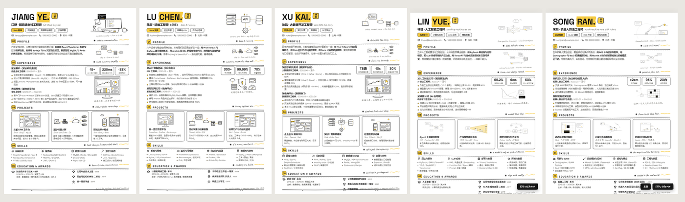
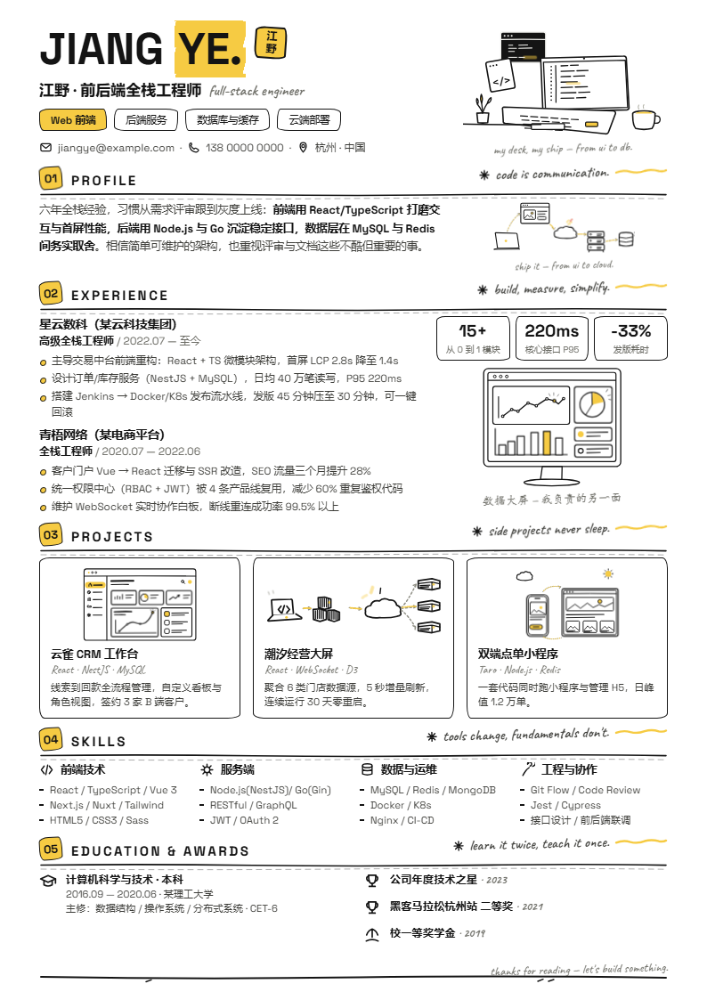
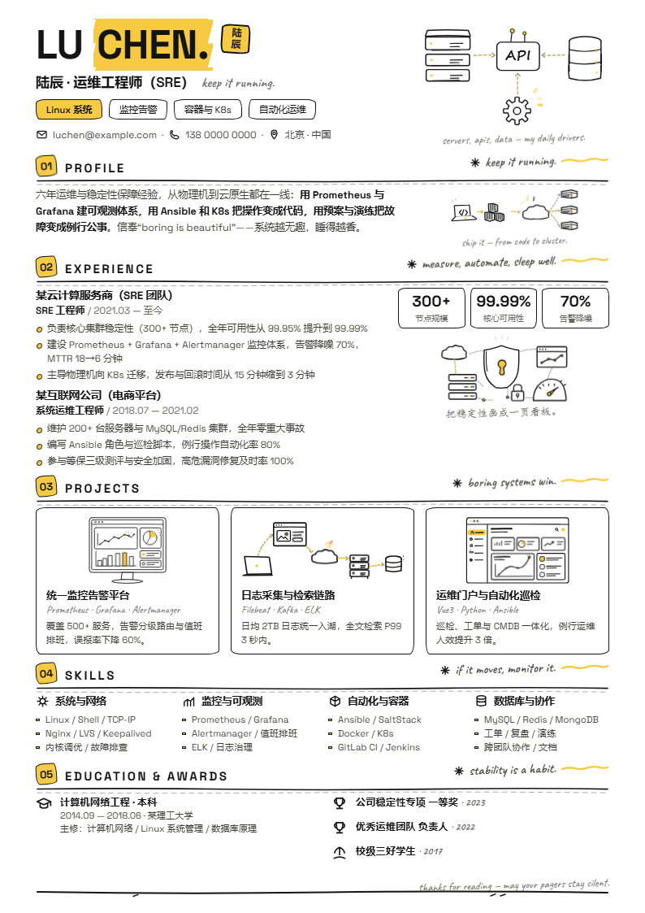
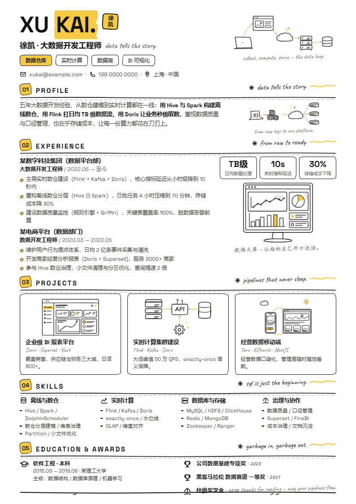
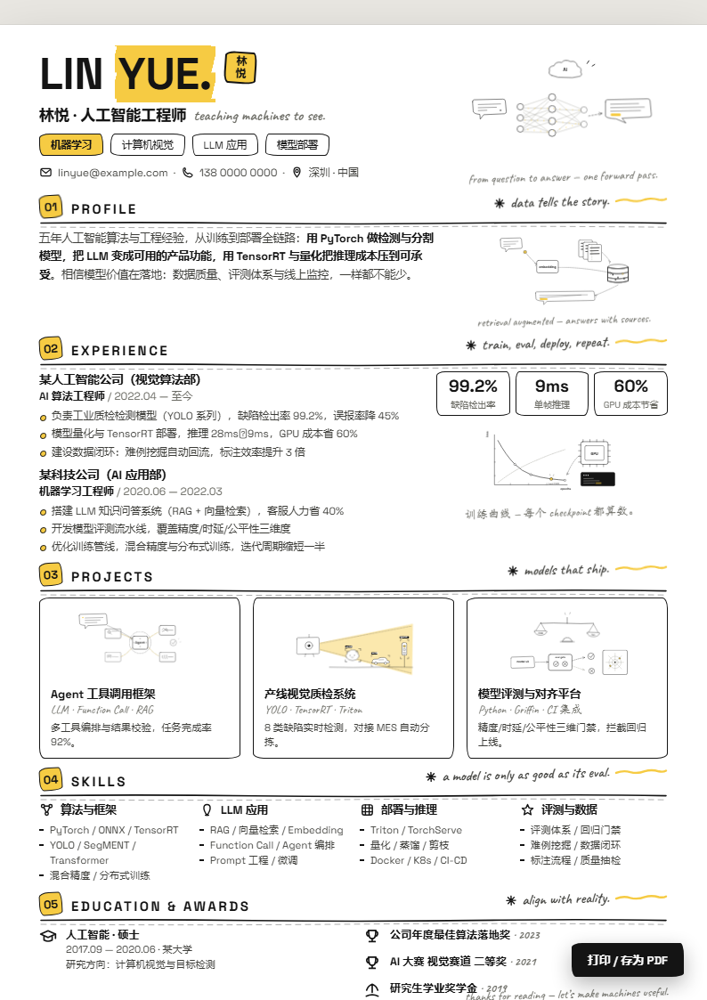
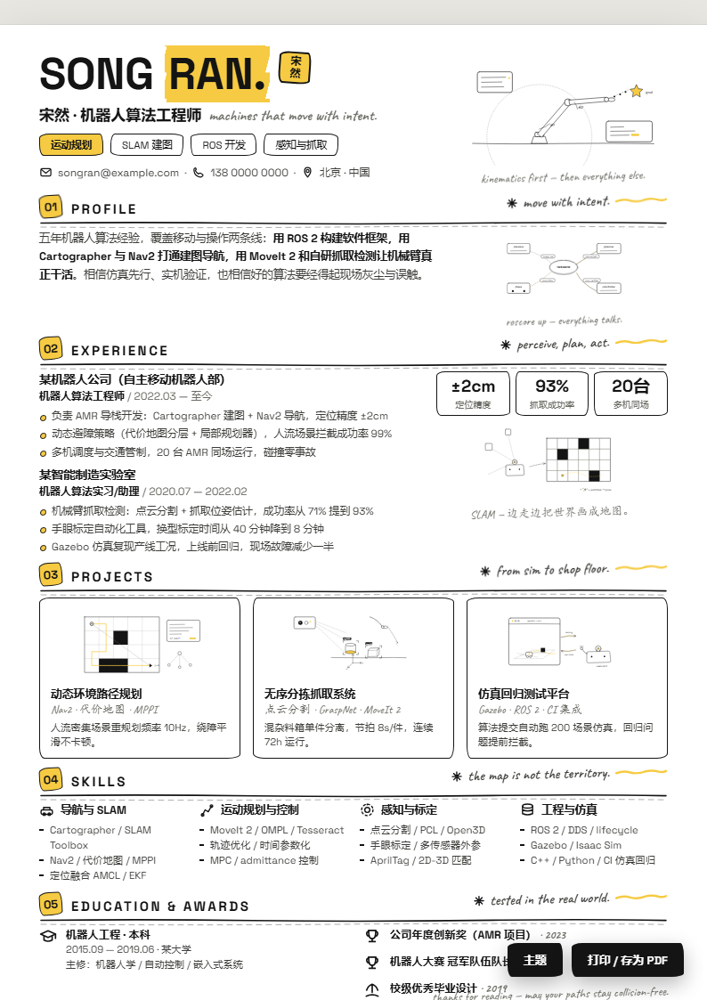

<div align="center">

🌐 **本项目已链接并认可 [LINUX DO 社区](https://linux.do/)**

[](examples/)

# 🎨 a4-doodle-resume-skill

**手绘涂鸦风 · 恰好一页 A4 · 网页简历生成器**

*Hand-drawn doodle-style one-page A4 web resume generator*

[](LICENSE)
[]()
[]()
[]()
[]()

**5 careers · 30 hand-drawn SVG illustrations · live theming · one file, one page, zero requests**

[快速开始](#-快速开始) · [在线示例](#-五份成品) · [六步工作流](#️-六步工作流) · [主题切换](#-主题切换骨架级) · [踩坑台账](#-踩坑台账-13-条)

</div>

---

## ✨ 这是什么

把一个职业人设,变成一份**像手账一样好看**的简历网页:

- 🖊️ **手绘涂鸦风** — 黑墨抖动线条 + 圆头端点 + 白填充遮挡,黄点缀克制(每页 6-8 处)
- 🖼️ **6 幅手绘 SVG 插画** — 按职业主题原创或从 23 幅图库借用,全部带描边入场 + 循环微动效
- 📄 **恰好一页 A4** — 794×1123px 逐节预算,`@page` 打印导出 PDF 不会多出第二页
- 🌈 **主题实时换色** — 6 主题色板 + 4 底色板 + 自定义取色器,插画颜色跟着变(组件零改动)
- 📦 **单文件 187KB** — 字体 base64 内嵌,零外部请求,断网可开,微信/QQ 直接发
- ♿ **贴心的细节** — 减动效自动静态、打印自动终态、触控目标 ≥44px、可选中可搜索的 PDF

## 🖼️ 五份成品

| | | | | |
|---|---|---|---|---|
|  |  |  |  |  |
| **江野** 前后端全栈 | **陆辰** SRE 运维 | **徐凯** 大数据开发 | **林悦** 人工智能 | **宋然** 机器人算法 |

→ 点击 [examples/](examples/) 查看单张大图与 PDF。

## 🚀 快速开始

```powershell
# 1. 打开任一成品(无需安装任何东西)
start examples/ai/index.html

# 2. 想换职业?复制一个示例目录,改文案,重新组装
cd examples/ai
python assemble.py

# 3. 导出打印 PDF + 主题回归
node tools/print_pdf.mjs index.html resume.pdf
node tools/theme_regression.mjs    # 必须 PASS
```

> 每份成品右下角:**「主题」** 实时换色 · **「打印 / 存为 PDF」** 一键导出

## 🗂️ 目录结构

```text
├─ SKILL.md                       Agent 技能规范(六步流程 + 铁律 + 完成定义)
├─ template/index.template.html   骨架源模板(样式/主题/动效/工具条)
├─ assets-library/                🖼️ 23 幅手绘插画图库(INDEX.md 按职业索引)
├─ original-assets-sample/        纯原创参考(AI 主题 7 幅)
├─ template-assets-sample/        白底化参考(全栈主题 5 幅)
├─ fonts/                         Space Grotesk + Caveat(base64)
├─ tools/                         print_pdf · pageshot · theme_regression · svgshot2
└─ examples/                      fullstack / ops / bigdata / ai / robo
```

## 🛠️ 六步工作流

| 步骤 | 内容 | 关键产出 |
|---|---|---|
| 1️⃣ 素材白底化 | 黑底 SVG → 白底变体(裁切/变色/描边倍率) | `make_light.py` |
| 2️⃣ 字体内嵌 | Space Grotesk + Caveat base64,`display:block` | `fonts/` |
| 3️⃣ A4 垂直预算 | 794×1123 逐节分配,插画高度是最大变量 | 预算表 |
| 3.5 插画来源决策 | 先查图库借用,不够就原创(默认) | 6 幅 SVG |
| 4️⃣ 版式自有设计 | 黄章节头 + 手写格言 + 速写双线 + 印章 | `*-body.frag.html` |
| 5️⃣ 模板组装 | 骨架 + 片段 + 素材 + 字体 → 单文件 | `assemble.py` → `index.html` |
| 6️⃣ 验证 | 截图 + PDF 1 页 + 主题回归 PASS | `resume.pdf` |

**新职业三件套**:改一份文案片段 + 换一张插画映射表 + 调一组描边倍率,其余(骨架/主题/动效/验证)全部继承。

## 🌈 主题切换(骨架级)

右下角「主题」按钮:**6 主题色板 + 4 底色板 + 自定义取色器**,实时生效,localStorage 记忆。

实现机制(插画源码零改动):
```css
/* CSS 变量 + 属性选择器接管 SVG 硬编码色 */
--accent: #F6CB43;  --accent-ink: /* 亮度自适应翻字色 */;  --paper: #ffffff;
.page [fill="#F6CB43"] { fill: var(--accent); }
.page [stroke="#F6CB43"] { stroke: var(--accent); }
```
回归:`node tools/theme_regression.mjs` → 每份简历 PASS(弹层/色板/切换/记忆/恢复)。

## 🎨 插画图库(23 幅)

`assets-library/` 黑白双色系,`INDEX.md` 按职业索引:仪表盘 / API 架构 / 数据链路 / 容器部署 / 数据大屏 / 开发工位 / 响应式 / 安全盾 / 神经网络 / 训练曲线 / Chatbot / Agent 环 / 相机臂 / 安全评估 / 视觉工装 / **手眼标定** / 传感融合 / 桌面检测 / **AGV 导航** / **位姿抓取** / 分拣流水线 …

借用三条件:语义完全吻合 / 无需大改构图 / 可独立提取。不合就原创(流程见 SKILL.md 第 3.5 步)。

## ⚠️ 踩坑台账(13 条,全部实战踩过)

<details>
<summary>展开查看</summary>

1. 全角标点用 `&#xFFxx;` 实体写入(手打会"丢 x"成无效引用,assemble 自检兜底)
2. 通栏 SVG `non-scaling-stroke` 宽屏发稀 → 随视口缩放 + 移动端补偿线宽
3. 闭合 path 描边连内侧一起画 → 融合剪影用开放路径
4. 同元素 pop 入场与循环动画冲突 → 外包 `<g>` 分离
5. 后台 dev 服务别接管道(SIGPIPE 杀进程)
6. 虚线流动无缝:dashoffset 位移 = dash 周期整数倍
7. 关节衔接:臂段端点止于关节圆心,关节圆后画盖线头
8. 黄色配额纪律:位置数量与设计稿一一对应
9. 触控目标 ≥44px
10. 文本换行拆词:`white-space: nowrap`
11. 正则批量替换几何属性必须 `count=1`
12. 无宽高 `<svg>` 默认 300×150,装饰 svg 必须显式尺寸
13. 字符引用两类坑(`&#2192;`≠→)+ `list-style:none` 防双标记 + 原创 SVG 内联前剥 `<style>` 且 scene id 命名空间化

</details>

## 📄 内容声明

五份示例的人设、经历、联系方式均为**演示用虚构内容**(邮箱 example.com、电话占位),不代表任何真实人物。投递前请替换为真实信息(改片段文件后重新组装)。

## 🤝 贡献

欢迎提 Issue / PR:新职业示例、新插画(遵守黄色配额与手绘笔触体系)、新动效类(须带减动效与打印兜底)。

<div align="center">

**🌐 Connected with [LINUX DO Community](https://linux.do/)**

*如果这个项目对你有帮助,欢迎去 LINUX DO 找我们玩 —*

</div>
